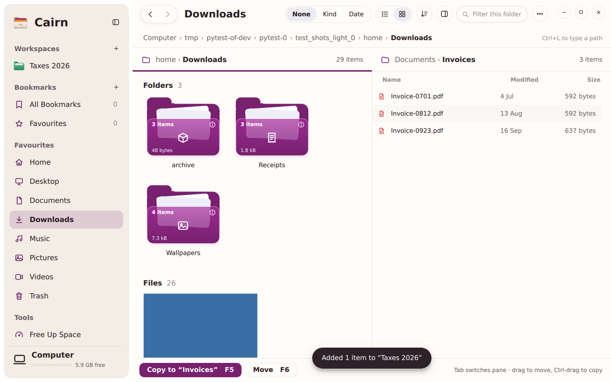
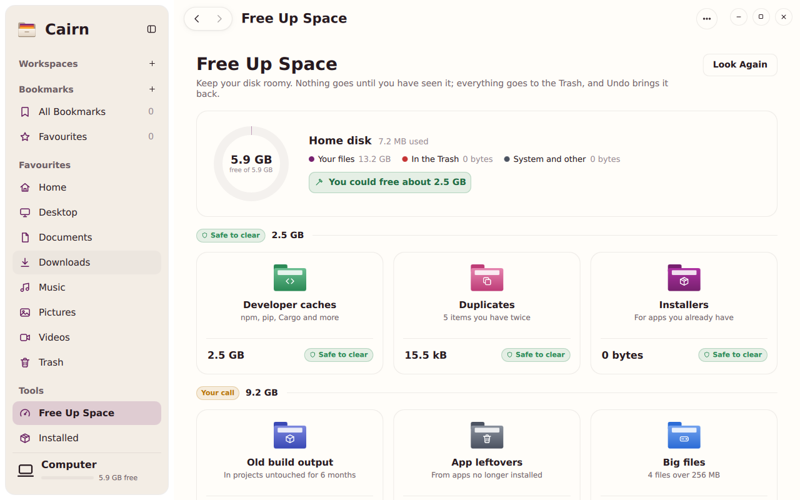
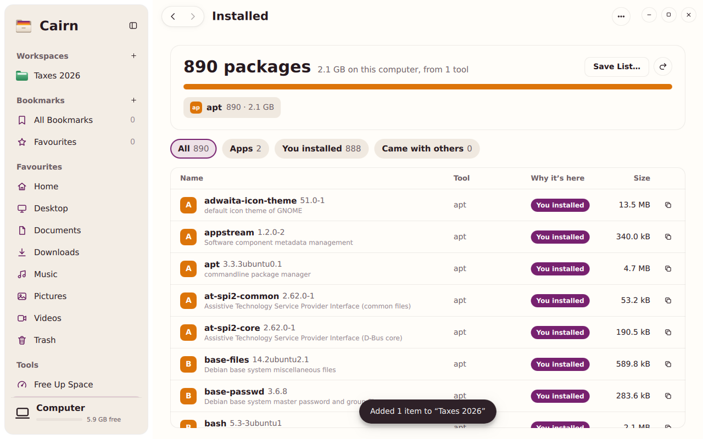
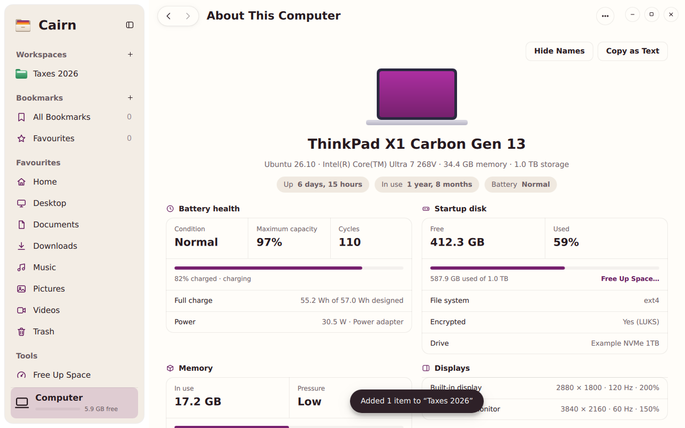

<div align="center">
  
  <h1>Steward</h1>
  <p><strong>The file manager for Ubuntu that keeps your folders tidy.</strong><br>
  Sort a messy Downloads in one click, free up space safely, and undo anything.</p>

  <a href="LICENSE"></a>
  
  
  

  <p>
    <a href="#install"><strong>Install</strong></a> ·
    <a href="#features">Features</a> ·
    <a href="#screenshots">Screenshots</a> ·
    <a href="#build-from-source">Build from source</a> ·
    <a href="#contributing">Contribute</a>
  </p>
</div>


> [!NOTE]
> Steward is approaching its first release (1.0). The features below are built
> and covered by automated end-to-end tests; checks on real desktops are under
> way, and packages are not published yet.

## Why Steward

Files pile up: downloads you meant to sort, caches nobody cleans, projects
spread over five folders. Steward looks after them the way a good steward
looks after a house. It knows where everything is, keeps things in order,
clears out what is not needed, and **always shows you the plan first**.
Nothing is deleted outright (it goes to the Trash), and one **Undo** puts
everything back.

Your files stay where they are. Nothing is uploaded and nothing is tracked.

## Features

**Find anything**
- Find any file or folder by name as you type (`Ctrl+K`), and search inside
  documents, PDFs and code
- Folder sizes and item counts on every folder, worked out in the background
- Peek at a file with `Space`, without opening it

**Keep things in order**
- **Tidy** sorts a messy folder (Downloads, Desktop) into neat kind folders,
  after showing you the plan
- **Workspaces** gather a project's folders and files from anywhere on one page
- **Dual pane**: two folders side by side, with copy and move across
- **Shelf**: a place to hold files while you work, a key press away

**Free up space, safely**
- **Free Up Space** finds caches, old installers, duplicates and leftovers of
  removed apps, explains why each is safe to clear, and moves only what you
  tick to the Trash
- **Installed** lists what apt, Snap, Flatpak and the language tools installed
- **About This Computer**: battery health, storage and security at a glance

**For developers and writers**
- Open any folder in your terminal or editor
- Markdown preview with an outline, and Bookmarks for links
- A command line (`open`, `add-link`, `free-up-space`, …) and every shortcut
  can be changed

**At home on Ubuntu**
- Follows Ubuntu's light or dark style and its accent colour, or uses its own
- Results in Activities search, a tray icon, and start at login if you want
- Works with Files (Nautilus): drag and drop and copy and paste both ways
- In English, German, Spanish, French, Japanese and Simplified Chinese

## Screenshots

| | |
|---|---|
|  |  |
| **Dual pane**: copy and move across | **Free Up Space**: see why before anything goes |
|  |  |
| **Installed**: apt, Snap, Flatpak and more | **About This Computer** |

## Install

Steward supports **Ubuntu 24.04 LTS, 26.04 LTS and 26.10**.

| Channel | Status |
|---|---|
| **apt repository** (signed `.deb`, recommended) | Coming with 1.0 |
| **Flatpak** | Coming to Flathub after 1.0. Some features need the host and say so inside the sandbox |

Until then you can [build it from source](#build-from-source) and run it
against a safe, generated test home folder.

## Build from source

You need only **Docker (with Compose) and `make`**. No Rust, Qt or other
toolchain goes on your machine.

```sh
make init     # build the images and the fake home folder the app runs against
make app      # run the app
make check    # lint, unit tests and every end-to-end test
make deb      # build the .deb into dist/
make flatpak  # build the Flatpak bundle into dist/flatpak/
```

The development build always runs against a generated fake home folder,
never your real files. With Docker Engine the window opens on your desktop.
With Docker Desktop it is shown in your browser at <http://127.0.0.1:8085>.

How it is built, phase by phase: [DESIGN.md](DESIGN.md). Where it is up to:
[docs/PROGRESS.md](docs/PROGRESS.md). Architecture decisions: [docs/adr/](docs/adr/).

## Contributing

Bug reports, ideas and pull requests are welcome. Read
[CONTRIBUTING.md](CONTRIBUTING.md) first: every change comes with its test,
and `make check` must stay green.

**Translations:** the messages are in [po/](po/). Corrections to the five
existing languages are especially welcome, since they are first drafts.

Please follow the [Code of Conduct](CODE_OF_CONDUCT.md). Security issues: see
[SECURITY.md](SECURITY.md).

## Licence

Steward is free software under the [GNU GPL, version 3 or later](LICENSE).
